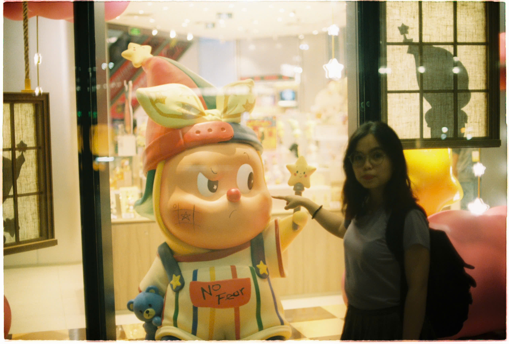

# 🍮 nguyễn phạm xuân nhi 🍮

  <code>software engineering</code> &nbsp;&bull;&nbsp; <code>front-end</code> &nbsp;&bull;&nbsp; <code>qa / testing</code> &nbsp;&bull;&nbsp; <code>applied ai</code>

> *“愿如春风，行至所爱，自成芳华。”*  

---

### ✦ About

* **School:** Software Engineering @ **FPT University HCMC** (2024 &ndash; 2028).
* **Focus & Passions:**
  * **Front-end Development** (ReactJS) & **UI/UX Design**.
  * **Software Testing / QA** (Manual & API Testing, aiming towards Automation).
  * Exploring **Applied AI**, **AI Agents** and **Data Science**.
* **Mindset:**  
  Always curious, open-minded, and super eager to learn from real-world projects, challenges & teammates.

---

### ✦ Tech Stack

* **Languages:**  
  `JavaScript` &nbsp;&bull;&nbsp; `Python` &nbsp;&bull;&nbsp; `HTML5` &nbsp;&bull;&nbsp; `CSS3` &nbsp;&bull;&nbsp; `SQL`

* **Frameworks & Libraries:**  
  `React` &nbsp;&bull;&nbsp; `Node.js`

* **Testing & Tools:**  
  `Postman` &nbsp;&bull;&nbsp; `Git` &nbsp;&bull;&nbsp; `GitHub` &nbsp;&bull;&nbsp; `Figma` &nbsp;&bull;&nbsp; `VS Code`

* **Workflow:**  
  `Agile / Scrum` &nbsp;&bull;&nbsp; `Software Requirements` &nbsp;&bull;&nbsp; `Test Case Design`

---

### ✦ A Quiet Frame

  <em>“no fear.”</em> 🎞️

---

### ✦ Connect

*open for hackathons & side projects. ping me if you have an idea.*

 

&nbsp;

&nbsp;

  

*feel free to reach out directly via facebook or zalo for a quick chat.*

